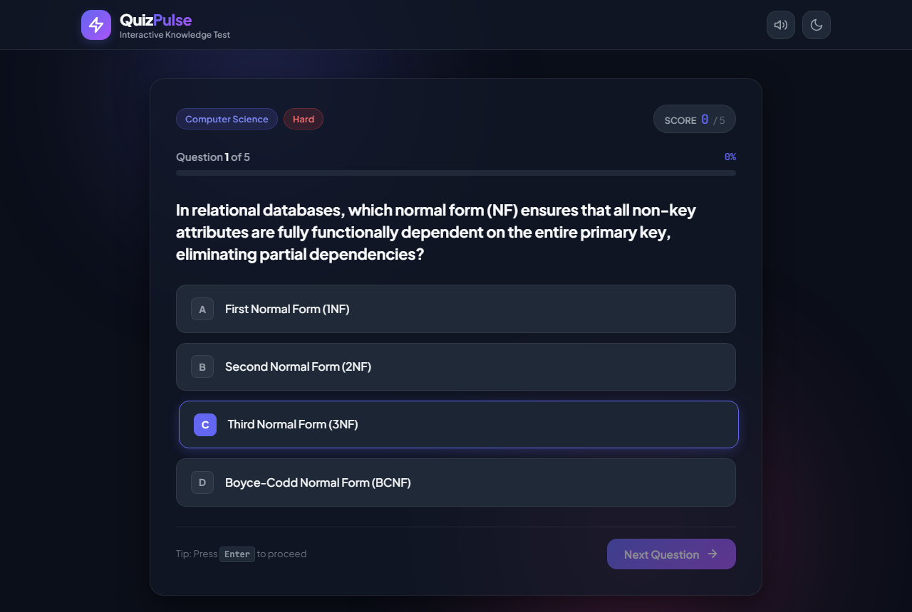
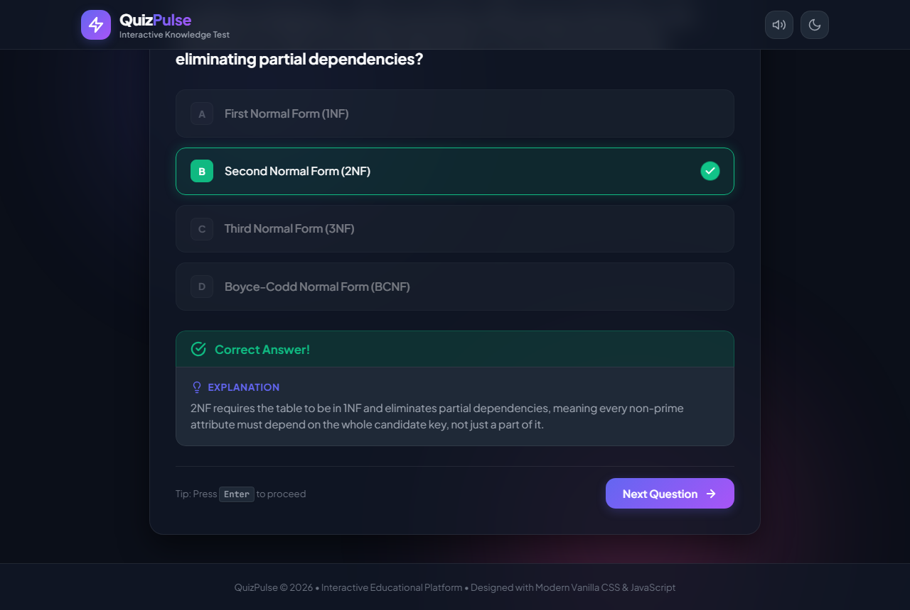
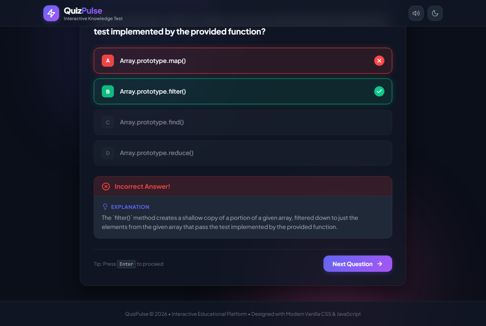
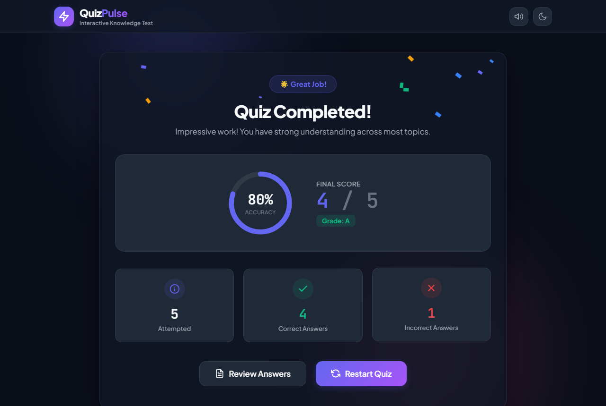
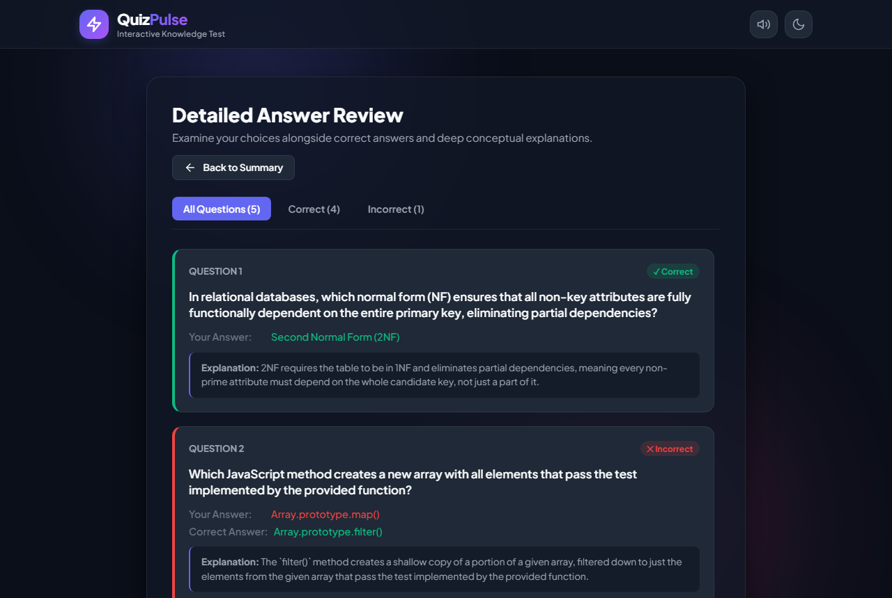

# QuizPulse — Interactive Quiz Website

> A modern, interactive, and responsive web platform designed to test technical concepts with instant visual feedback, real-time score tracking, comprehensive performance analytics, and complete answer reviews.

---

## 🌐 Live URLs

- **Live Hosted Application:** [https://ziyakausar07.github.io/quiz-website/](https://ziyakausar07.github.io/quiz-website/)
- **GitHub Repository:** [https://github.com/ziyakausar07/quiz-website.git](https://github.com/ziyakausar07/quiz-website.git)

---

## 🎯 1. Project Overview & Objectives

**QuizPulse** is an educational, interactive multiple-choice quiz application built from the ground up using modern web standards. The project objective is to provide a seamless, engaging, and accessible testing environment across desktop, tablet, and mobile devices.

### Key Objectives
1. **Dynamic Question Delivery:** Seamlessly load multiple-choice questions from a structured JSON dataset without hardcoded quiz logic.
2. **Instant Visual Feedback:** Provide immediate color-coded indicators (emerald green for correct, ruby red for incorrect) alongside conceptual explanations right after answering.
3. **Real-Time Score Calculation:** Dynamically compute scores, percentages, and progress metrics with zero page reloads.
4. **Comprehensive Evaluation & Review:** Deliver an interactive final results dashboard with circular SVG score gauges, performance badges, celebration animations, and a dedicated question-by-question review screen.
5. **Fluid State Management & Reset:** Enable full quiz restarts that reset application state, option buttons, and score variables cleanly without refreshing the browser.

---

## ✨ 2. Core Features

### 🖥️ Interactive Quiz Interface
- **Single Question Focus:** Displays one question at a time to maximize user focus.
- **4 Answer Options:** Clearly labeled option buttons (`A`, `B`, `C`, `D`) with hover lift and focus outlines.
- **Dynamic Question Counter:** Shows real-time progress (e.g., *"Question 3 of 10"*).
- **Animated Progress Bar:** Fluid progress bar indicating completed questions and percentage.
- **Category & Difficulty Badges:** Color-coded tags (Web Development, JavaScript, Computer Science; Easy, Medium, Hard).

### ⚡ Instant Answer Feedback
- **Color-Coded Status:** Highlights the correct answer in vivid green (`#10b981`) and incorrect selections in red (`#ef4444`) with corresponding icons (`✓` / `✕`).
- **Feedback Banner:** Displays an animated banner with *"Correct Answer!"* or *"Incorrect Answer!"*.
- **Conceptual Explanations:** Explains the reasoning behind the correct answer to facilitate learning.
- **Single-Submission Lock:** Immediately disables all 4 options once an answer is chosen, preventing duplicate inputs or score tampering.
- **Next Question Transition:** Prompts users to continue via a highlighted *"Next Question"* button (or *"View Final Results"* on the final question).

### 📊 Real-Time Score Tracking
- Score updates instantly on correct responses without page refreshes.
- Live score badge in the header shows current score vs. total possible points.

### 🏆 Final Results Dashboard
- **Circular SVG Gauge:** Animates the user's accuracy percentage.
- **Performance Evaluation:** Dynamically assigns performance badges and messages:
  - `90% - 100%`: 🏆 *Mastermind! (Grade: A+)*
  - `75% - 89%`: 🌟 *Great Job! (Grade: A)*
  - `60% - 74%`: 👍 *Solid Effort! (Grade: B)*
  - `40% - 59%`: 📚 *Keep Learning! (Grade: C)*
  - `< 40%`: 🌱 *Room for Growth!*
- **Stats Grid:** Summarizes total questions attempted, correct answers, and incorrect answers.
- **Celebration Confetti:** Canvas-based celebratory confetti effect triggers for scores of 60% and above.

### 🔍 Detailed Answer Review
- Full review panel listing every question attempted.
- Filter tabs: **All Questions**, **Correct Only**, and **Incorrect Only**.
- Side-by-side comparison displaying the user's choice, the correct answer, and the complete educational explanation.

### 🔄 Zero-Reload Quiz Restart
- Restarts the quiz instantly from question 1 without reloading the webpage.
- Resets score, question index, progress bar, answer history, and feedback elements.

### 🎨 Premium Aesthetics & Accessibility
- **Modern Glassmorphism:** Translucent glass cards with backdrop filters and ambient background glow.
- **Dark & Light Mode:** Toggleable color themes with persistent `localStorage` support.
- **Web Audio API Sound Effects:** Offline sound synthesizer providing audio cues for correct answers, mistakes, button clicks, and fanfare.
- **Keyboard Navigation:** 
  - Keys `1`–`4` or `A`–`D` to select options.
  - `Enter` / `Space` to advance to the next question.
- **Fully Responsive:** Custom media queries tailored for desktops, tablets, and mobile smartphones.

---

## 🛠️ 3. Technology Stack

| Layer | Technology | Description |
| :--- | :--- | :--- |
| **Structure** | HTML5 | Semantic elements (`<header>`, `<main>`, `<section>`, `<article>`, `<button>`) with ARIA attributes |
| **Styling** | Vanilla CSS3 | Modern CSS tokens (variables), Flexbox, CSS Grid, Glassmorphism, animations, responsive design |
| **Application Logic** | JavaScript (ES6+) | Centralized state management, DOM manipulation, Web Audio API synthesis, Canvas animations |
| **Data Storage** | JSON (`questions.json`) | Decoupled question bank with categories, difficulty ratings, options, answers, and explanations |

---

## 📂 4. Project Structure

```text
Quiz/
├── index.html              # Main HTML application structure
├── style.css               # Design system, glassmorphism, responsive styles & animations
├── script.js               # Centralized state machine, quiz logic, Web Audio synthesizer
├── questions.json          # Decoupled question dataset (16 technical questions)
├── .gitignore              # Git ignore rules for node_modules and scratch files
├── README.md               # Project documentation
└── screenshots/            # Verified interface screenshots
    ├── 01_initial_screen.png
    ├── 02_question_interface.png
    ├── 03_answer_feedback_correct.png
    ├── 03b_answer_feedback_incorrect.png
    ├── 04_final_results_screen.png
    ├── 05_answer_review_screen.png
    └── 06_light_theme_preview.png
```

---

## 📸 5. Interface Screenshots

### A. Initial Welcome Screen (Dark & Light Theme)

*Welcome screen offering category selection, question count options, and quiz feature overview.*


*Alternative light theme mode with high contrast and readable typography.*

---

### B. Interactive Question Interface

*Question card displaying category and difficulty tags, real-time score pill, question counter, progress bar, and 4 answer options.*

---

### C. Instant Answer Feedback

#### Correct Answer Feedback:

*Option highlighted in emerald green with checkmark badge, banner notification, and full conceptual explanation.*

#### Incorrect Answer Feedback:

*Selected option highlighted in red with shake animation, correct answer highlighted in green, and explanation displayed.*

---

### D. Final Results Dashboard

*Results summary featuring animated circular score gauge, grade rating, stat cards (attempted, correct, incorrect), and confetti celebration.*

---

### E. Detailed Answer Review

*Review breakdown with filter tabs (All, Correct, Incorrect), user choice vs. correct answer, and explanation notes.*

---

## 🧠 6. State Management & Logic Architecture

The quiz application is built around a single, centralized reactive state object in `script.js`:

```javascript
const state = {
  allQuestions: [],         // Master dataset loaded from questions.json
  activeQuestions: [],      // Filtered & randomized questions for the current run
  currentIndex: 0,          // 0-indexed question pointer
  score: 0,                 // Current score counter
  userAnswers: [],          // Complete answer history for review & statistics
  isAnswerSubmitted: false, // Prevents duplicate submissions per question
  isQuizCompleted: false,   // Completion flag
  categoryFilter: 'all',    // User's selected category
  questionCountLimit: 'all',// Selected question count (5, 10, or all)
  soundEnabled: true,       // Audio feedback preference
  currentTheme: 'dark'      // 'dark' or 'light'
};
```

### Key Functional Modules:

1. **`loadQuestionBank()`**: Fetches questions asynchronously from `questions.json`. Includes an embedded fallback dataset so the website runs smoothly even when opened directly via the `file://` protocol.
2. **`startQuiz()`**: Filters the question bank by category, shuffles questions, applies count limits, and resets all state variables.
3. **`renderQuestion()`**: Updates the DOM with the active question, tags, option buttons, counter (`Question X of Y`), and progress bar.
4. **`handleAnswerSelection(selectedOption, clickedButton)`**:
   - Guards against multiple submissions via `state.isAnswerSubmitted`.
   - Compares the choice against `currentQ.correctAnswer`.
   - Increments `state.score` on correct answers.
   - Triggers Web Audio chime or buzzer.
   - Updates option button styles (green for correct, red for incorrect, dims remaining options).
   - Injects the explanation and enables the *"Next Question"* button.
5. **`goToNextQuestion()`**: Advances `state.currentIndex` or delegates to `showResults()`.
6. **`showResults()`**: Calculates metrics, triggers confetti for scores $\ge 60\%$, updates circular SVG gauge offset, and renders stat cards.
7. **`populateReviewScreen(filter)`**: Populates the review list with options to filter by all, correct, or incorrect answers.
8. **`restartQuiz()`**: Cleans up all state variables and restarts the quiz immediately without a page reload.

---

## 🔄 7. User Interaction Flow

```text
+-----------------------+
|    Welcome Screen     |
| (Category & Count Sel)|
+-----------+-----------+
            |
            v  [Click "Start Quiz Now" or press Enter]
+-----------------------+
|  Question Interface   | <-------------------------+
| (One Question at time)|                           |
+-----------+-----------+                           |
            |                                       |
            v  [User clicks option or presses 1-4]   |
+-----------------------+                           |
| Instant Feedback Mode |                           |
| - Green / Red borders |                           |
| - Disabled options    |                           |
| - Explanation revealed|                           |
| - Live score updated  |                           |
+-----------+-----------+                           |
            |                                       |
            v  [Click "Next Question" or Enter]     |
     [Is more Qs?] ---- Yes ------------------------+
            |
            | No
            v
+-----------------------+
| Final Results Screen  |
| - Circular gauge      |
| - Attempted / Correct |
| - Confetti celebration|
+-----------+-----------+
     |             |
     | [Review]    | [Restart Quiz]
     v             v
+-----------+  Resets state & restarts from Q1
|  Answer   |
|  Review   |
+-----------+
```

---

## 🚀 8. How to Run Locally

### Option 1: Direct File Open
Double click `index.html` in your file explorer to open it directly in any modern browser (Chrome, Edge, Firefox, Safari).

### Option 2: Using Python HTTP Server (Recommended)
Open a terminal in the project directory and run:
```bash
python -m http.server 3000
```
Then visit: `http://localhost:3000`

### Option 3: Using Node.js / npx
```bash
npx serve .
# or
npx live-server
```

---

## 🚢 9. Deployment to GitHub Pages

To deploy this project to your repository and GitHub Pages:

```bash
# 1. Initialize git and stage all files
git init
git add .
git commit -m "feat: complete interactive quiz platform with responsive design and review screen"

# 2. Add your GitHub remote
git remote add origin https://github.com/ziyakausar07/quiz-website.git

# 3. Rename branch to main and push
git branch -M main
git push -u origin main
```

### Enabling GitHub Pages:
1. In your GitHub repository, navigate to **Settings** > **Pages**.
2. Under **Build and deployment** > **Branch**, select `main` and `/ (root)`.
3. Click **Save**. Within 1–2 minutes, your live site will be accessible at:
   `https://ziyakausar07.github.io/quiz-website/`

---

## 📜 10. Acceptance Criteria Checklist

- [x] **Questions & Options Load Dynamically:** Loaded from `questions.json` with categories, difficulty, and explanations.
- [x] **Question Counter & Progress Bar:** Dynamic updates with percentage indicators.
- [x] **Instant Visual Feedback:** Green checkmark for correct answers, red cross for incorrect choices.
- [x] **Accurate Scoring:** Points awarded solely for correct answers; real-time score display without page reload.
- [x] **Anti-Double Submission:** Options are immediately disabled after the first selection.
- [x] **Educational Explanations:** Displayed automatically after each answer.
- [x] **Comprehensive Results Screen:** Total attempted, correct/incorrect count, percentage, gauge, and performance message.
- [x] **Complete Review Screen:** Interactive review with filtering for all, correct, and incorrect answers.
- [x] **Zero-Reload Restart:** State and UI reset completely without refreshing the page.
- [x] **Responsive & Accessible Design:** Touch-friendly buttons, keyboard navigation (`1-4`, `A-D`, `Enter`), dark/light themes, WCAG-compliant contrast.
- [x] **Tested & Documented:** Complete documentation, clean code, no console errors, and verified screenshots included.
